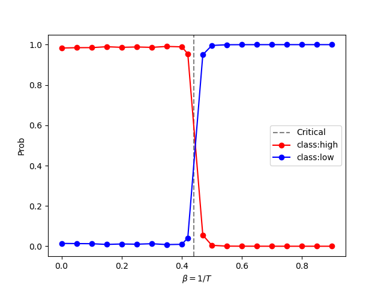
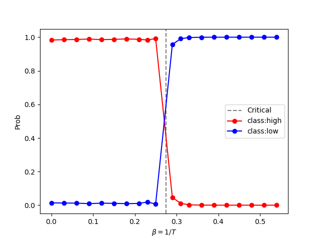
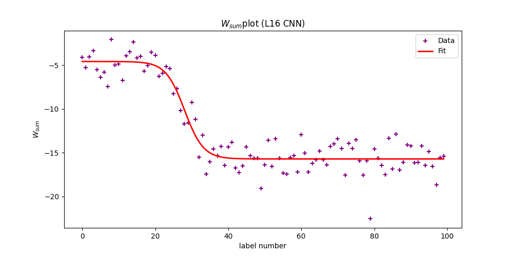
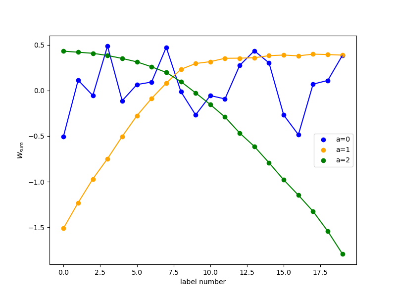

# 機械学習と2次元イジング模型における相転移検出

修士論文（2024年2月提出）のために行った再現実験のコードと結果をまとめたリポジトリです。

ニューラルネットワークで2次元イジング模型の**磁気相転移を検出する**3本の先行研究を、PyTorch で再実装して追試しました。

> **English summary** — Code and results from my master's thesis (Feb 2024). I re-implemented three papers on detecting the phase transition of the 2D Ising model with neural networks (Carrasquilla & Melko 2017; Tanaka & Tomiya 2017; Kashiwa, Kikuchi & Tomiya 2019) in PyTorch. Everything runs in Docker on CPU.

---

## 研究の概要

イジング模型は、格子上のスピン（上向き +1／下向き −1）が隣のスピンとそろおうとする、磁石の最も単純なモデルです。2次元では、ある温度（臨界温度）を境に、スピンがバラバラな**常磁性相**から、そろった**強磁性相**へ相転移します。正方格子の臨界点は厳密に分かっています（逆温度 βc ≈ 0.4407）。

この研究では「スピンの配置の画像だけを見せたニューラルネットワークは、相転移を見つけられるか」「見つけられるなら、ネットワークの中で何が起きているか」を、次の3段階で調べました。

| # | 元論文 | 何をするか | フォルダ |
|---|---|---|---|
| 1 | Carrasquilla & Melko (2017) | 配位が強磁性相か常磁性相かを2値分類する（**相の分類器**）。正方格子で学習したモデルを三角格子にも適用 | [01_carrasquilla_melko](experiments/01_carrasquilla_melko/) |
| 2 | Tanaka & Tomiya (2017) | 配位から温度を当てる（**温度測定器**）。相転移の情報を与えなくても、学習した重みから臨界点が読み取れる | [02_tanaka_tomiya](experiments/02_tanaka_tomiya/) |
| 3 | Kashiwa, Kikuchi & Tomiya (2019) | 温度測定器の内部を解析し、全結合ネットワークは**磁化**を、畳み込みネットワークは**内部エネルギー**をとらえていることを確かめる | [03_kashiwa_kikuchi_tomiya](experiments/03_kashiwa_kikuchi_tomiya/) |

研究の背景と各実験の流れは [docs/research_overview.md](docs/research_overview.md) にまとめています。

## 主な結果

| 相の分類器（正方格子） | 正方格子で学習 → 三角格子に適用 |
|---|---|
|  |  |
| 出力は厳密な臨界点（破線）で入れ替わる | 三角格子の臨界点（βc ≈ 0.2747）でも入れ替わる。格子の形によらない特徴を学んでいる |

| 温度測定器の重み（L=16, CNN） | 隠れ層3ユニットの重み（L=16, CNN） |
|---|---|
|  |  |
| 温度ラベルごとの重みの和は、臨界点付近で急に変化する。tanh でフィットした中心から臨界温度を推定できる | 重みは温度に対してなめらかに変化する。論文で示された「内部エネルギーをとらえる」振る舞いと対応する |

## 動かし方

### 必要なもの

- [Docker Desktop](https://www.docker.com/products/docker-desktop/)（Windows / macOS）または Docker Engine（Linux）
- GPU は不要です（CPU 版の PyTorch を使用）

### 1. 起動

```bash
git clone https://github.com/Chansuga/ising-ml-phase-transition.git
cd ising-ml-phase-transition
docker compose up --build
```

ブラウザで <http://localhost:8888> を開くと JupyterLab が表示されます。

### 2. データの生成

スピン配位のデータ（合計約 130 MB）はリポジトリに含めていません。JupyterLab のターミナルで次のコマンドを実行して生成します。

```bash
python scripts/generate_data.py all
```

実験ごとに生成することもできます（`carrasquilla` / `tanaka` / `kashiwa`）。格子サイズや逆温度の範囲、配位の数などのパラメータも変えられます。設定できる項目は `python scripts/generate_data.py tanaka -h` のように確認してください。

### 3. ノートブックの実行

各実験フォルダの README に、ノートブックを実行する順番を書いています。学習済みのモデル（`data/*.pth`）はリポジトリに含めているので、重みの解析（`prm_analysis_*.ipynb`）はデータを生成しなくても実行できます。

<details>
<summary>Docker を使わない場合（uv）</summary>

[uv](https://docs.astral.sh/uv/) を使います。Python 3.11 と CPU 版の PyTorch が自動で入ります。

```bash
uv sync                  # .venv に環境を作る
uv run jupyter lab
```

VS Code などでノートブックを開くだけなら、`uv sync --no-group lab` で JupyterLab を省けます（カーネルには `.venv` を選びます）。

</details>

## ディレクトリ構成

```
.
├── experiments/
│   ├── 01_carrasquilla_melko/      # 相の分類器（正方格子・三角格子）
│   ├── 02_tanaka_tomiya/           # 温度測定器による相転移検出
│   └── 03_kashiwa_kikuchi_tomiya/  # 温度測定器の重みの解析
│       ├── *.ipynb                 #   実験ノートブック（当時のコードそのまま）
│       ├── data/                   #   学習済みモデル (*.pth)・生成したデータ
│       └── image/                  #   実験で出力した図
├── scripts/generate_data.py        # スピン配位データの生成（Numba で高速化）
├── docs/                           # 研究概要・参考文献
├── Dockerfile
├── docker-compose.yml
├── pyproject.toml / uv.lock        # 依存ライブラリ（uv で管理）
```

## 補足

- ノートブックは修士論文を書いた当時のコードです。公開にあたって変更したのは、ファイル名の誤字修正、データの保存先フォルダの修正、実行環境に依存する出力の削除だけです。当時のコードの既知の問題は、各実験の README に書いています。
- 修士論文の本文と、参考にした論文の PDF・図は、著作権と個人情報の保護のため含めていません。元論文は [docs/references.md](docs/references.md) から参照してください。

## ライセンス

[MIT License](LICENSE)
